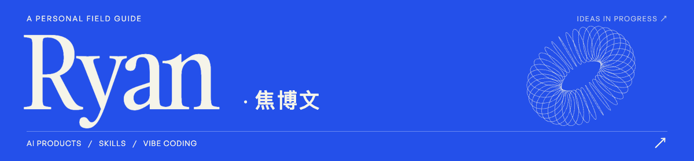

  <picture>
    <source media="(prefers-reduced-motion: reduce)" srcset="assets/ryan-slogan-static.svg">
    
  </picture>

  
  

<!-- PROJECTS_START -->
## 📂 Projects

<table>
  <tr>
    <td width="50%" valign="top">
      <h3><a href="https://github.com/BMBWaveforms/guoman-character-designer" title="BMBWaveforms/guoman-character-designer">Guoman Character Designer&nbsp;↗</a></h3>
      
国漫角色四视图的中文提示词 Skill。

      

    </td>
    <td width="50%" valign="top">
      <h3><a href="https://github.com/BMBWaveforms/LifeOS" title="BMBWaveforms/LifeOS">LifeOS · My Fork&nbsp;↗</a></h3>
      
个人分支，探索指南问答与长期记忆。

      

    </td>
  </tr>
  <tr>
    <td width="50%" valign="top">
      <h3><a href="https://github.com/BMBWaveforms/Ryan-Home" title="BMBWaveforms/Ryan-Home">Ryan Home&nbsp;↗</a></h3>
      
个人网站，记录 AI 产品与网页设计探索。

      

    </td>
    <td width="50%" valign="top">
      <h3><a href="https://github.com/BMBWaveforms/single-agent-analysis" title="BMBWaveforms/single-agent-analysis">Agent Analysis&nbsp;↗</a></h3>
      
拆解 Agent 上下文、工具调用与运行逻辑。

      

    </td>
  </tr>
  <tr>
    <td width="50%" valign="top">
      <h3><a href="https://github.com/BMBWaveforms/single-competitor-analysis" title="BMBWaveforms/single-competitor-analysis">Competitor Analysis&nbsp;↗</a></h3>
      
按五层方法研究竞品，梳理定位与机制。

      

    </td>
    <td width="50%" valign="top">
      <h3><a href="https://github.com/shuaishuaisylas/LifeOS" title="shuaishuaisylas/LifeOS">LifeOS · Upstream&nbsp;↗</a></h3>
      
上游项目，提供指南问答与长期记忆。

      

    </td>
  </tr>
</table>
<!-- PROJECTS_END -->

## 🛠️ Working stack

<strong>Daily</strong> &nbsp;
  
  
  
  

<strong>AI</strong> &emsp;&nbsp;
  
  
  

<strong>Focus</strong> &nbsp; AI&nbsp;Products &nbsp; · &nbsp; Vibe&nbsp;Coding &nbsp; · &nbsp; Open&nbsp;Source &nbsp; · &nbsp; Writing

<!-- SOCIAL_LINKS_START -->
## ✍️ Writing & Sharing

<!-- ARTICLES_START -->

  <code>01</code> &nbsp; <a href="https://mp.weixin.qq.com/s/iUHAtnVoobJoRqYGRLH51A"><strong>从 Prompt 到 Context：一次 Agent 推理前，上下文究竟是怎么构建的？ ↗</strong></a>

  <code>02</code> &nbsp; <a href="https://mp.weixin.qq.com/s/r6MzV7tIkW_UUMyRPgCWog"><strong>技术封建主义：AI 时代的又一次圈地运动 ↗</strong></a>

  <code>03</code> &nbsp; <a href="https://mp.weixin.qq.com/s/2XnkbL4d0gcHSVc1u2QWsw"><strong>聊聊模型评测：为什么你的大模型"跑分很高"，一上线就翻车？ ↗</strong></a>

  <code>04</code> &nbsp; <a href="https://mp.weixin.qq.com/s/tcH8_DMEWu-QRyvBsFlnig"><strong>AI 正在加速我对世界的消耗 ↗</strong></a>

<!-- ARTICLES_END -->

  <picture>
    <source media="(max-width: 600px)" srcset="assets/social-card-mobile.png">
    
  </picture>

**公众号「碳基推理中」**：用微信扫码关注，或在微信「搜一搜」中搜索名称。[查看公众号二维码](assets/wechat-qr.jpg)

手机浏览可直接打开 [小红书主页 ↗](https://xhslink.cn/o/13OQAkBmW7Q)，或 [查看小红书二维码](assets/xiaohongshu-qr.png)。
<!-- SOCIAL_LINKS_END -->

---

欢迎交流 AI 产品、Vibe Coding 与 AI 对世界的改变。

 &nbsp; [Ctaisobserving@gmail.com](mailto:Ctaisobserving@gmail.com)
